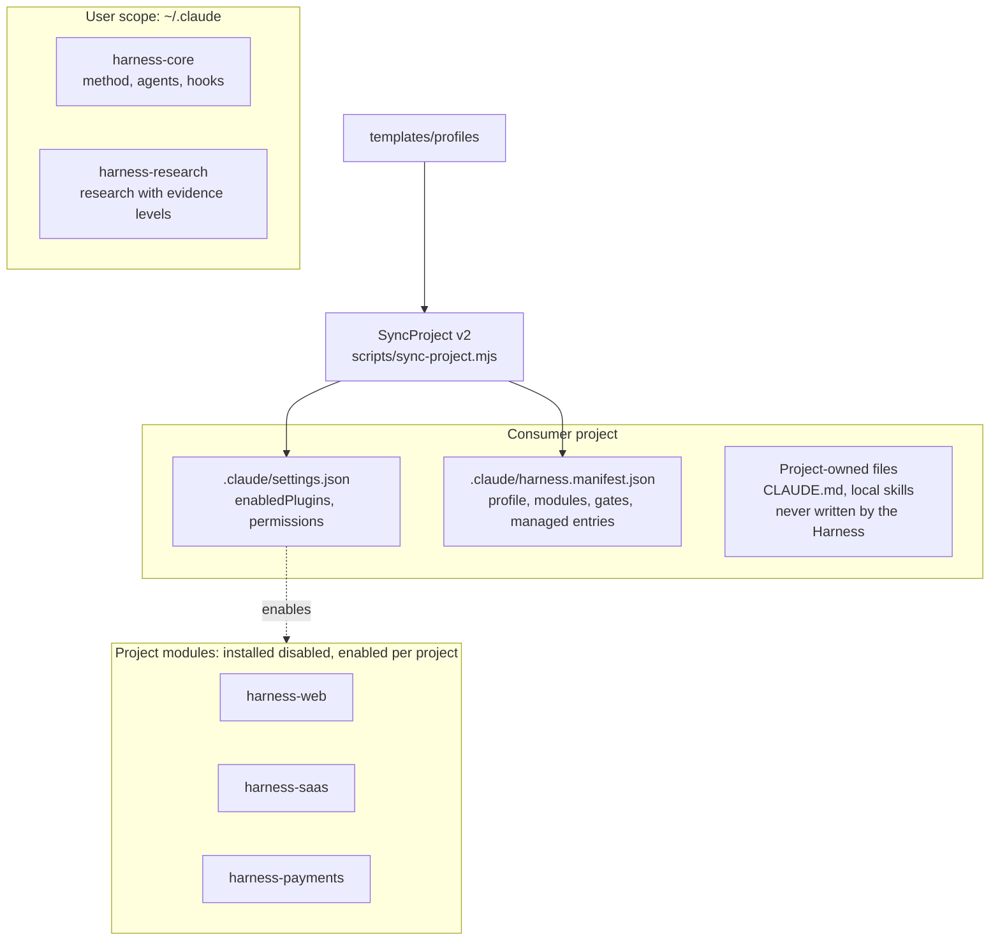
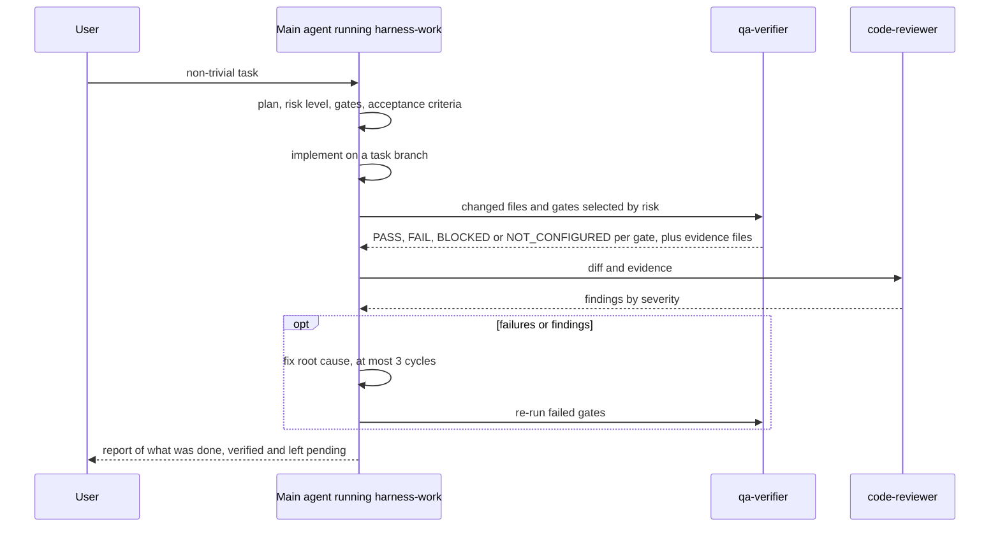
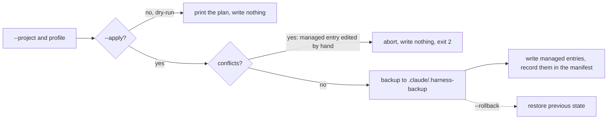

# Claude Code Harness

**A Modular Engineering Framework for AI-Assisted Web and SaaS Development.**

[](https://github.com/MarBlanco/ClaudeCode-agentes-skills/actions/workflows/harness-ci.yml)
[](LICENSE)

Claude Code Harness targets the development of web applications and SaaS products: front end, back end and APIs, authentication, databases, multi-tenancy, payments, QA and security. It is a *harness* for [Claude Code](https://claude.com/claude-code): a set of plugins that adds a working method, specialised agents, preventive hooks and evidence-based verification on top of the assistant, and a tool (SyncProject v2) that applies it to each project without overwriting the project's own configuration.

> **Core idea:** whoever implements a change does not certify it. Verification is delegated to a separate agent that has no edit tools, its output is stored as evidence, and every claim in this repository is meant to be backed by a test, a reproducible run, or an explicitly stated limitation.

> **Language note:** the code and this README are in English; the internal documentation (`docs/`, skills, ADRs) is written in Spanish.

## What it is, in plain terms

Claude Code can read and edit your code, run commands and use *plugins* (bundles of skills, agents and hooks). On its own, an autonomous assistant can declare work "done" because it compiles, touch sensitive files, retry without limit, or lose context between sessions. The Harness addresses those risks with concrete mechanisms:

| Risk | Mechanism | Kind of control |
|---|---|---|
| Declaring work done without evidence | `qa-verifier` agent runs the selected quality gates (G1–G9) and stores command output in `.harness/evidence/` | Verifiable process |
| Self-approval | Implementation, verification (`qa-verifier`) and review (`code-reviewer`) are separate roles with different tool lists | Per-agent permissions |
| Reading or changing secrets, lockfiles, committed migrations | `PreToolUse` hook (the *guard*) **denies** the call | Preventive |
| Destructive or production operations | The guard asks for confirmation (push, hard reset, `DROP`, `vercel --prod`, publish…) | Confirmation |
| Endless repair loops | At most 3 repair cycles, then stop and report | Workflow rule |
| An exploratory QA agent leaving its scope | Per-agent policy for `qa-explorer` plus a browser network restricted to localhost | Preventive, with declared limits |
| Losing context between sessions | Session-continuity hook and a memory policy | Assistance, not guaranteed |
| Project configuration drifting | **SyncProject v2**: idempotent profile application with conflict detection, backup and rollback | Preventive |

## Architecture



| Plugin | Scope | Responsibility |
|---|---|---|
| `harness-core` | user, always on | Method skills (`product-spec`, `architecture-decisions`, `harness-plan`, `harness-work`, `harness-review`, `systematic-debugging`, `ops-delivery`, `tech-docs`, `maintenance-upgrades`, `memory-policy`), agents `code-reviewer` and `qa-verifier`, the gate catalogue, and all hooks |
| `harness-web` | per project | Front-end and web QA: `frontend-design`, `design-loop`, `web-design-guidelines`, `vercel-react-best-practices`, `vercel-composition-patterns`, `playwright-cli`, `chrome-devtools`, `web-qa`, `qa-explore`, `seo`, `owasp-security`; agent `qa-explorer` |
| `harness-saas` | per project | `saas-architecture` (tenancy, auth, roles, plans), `api-design` (APIs, webhooks), `data-modeling-migrations`, `supabase-postgres-best-practices` |
| `harness-payments` | per project | `payments-core` (invariants plus tested reference code), `payments-review` (G9 matrix); agent `payments-engineer` |
| `harness-research` | user | `market-research` and `web-research` (evidence levels `verified_sales` / `popularity` / `hypothesis`, sources cited, figures never invented) and five skills vendored from Anthropic (`competitive-brief`, `campaign-plan`, `product-brainstorming`, `statistical-analysis`, `validate-data`); agent `market-researcher` |

A *profile* (`templates/profiles/`: `vite-supabase`, `next-supabase`, `next-payload`, `django-react`) selects modules, optional MCP servers, permissions, gate commands and CI files for a stack. Skills are loaded only in the projects that enable their module, to avoid spending context on unused capabilities.

Design decisions and rejected alternatives: [`docs/DECISIONS.md`](docs/DECISIONS.md) (ADR-001 … ADR-018). Capability matrix with the real verification status of each item: [`docs/CAPABILITIES.md`](docs/CAPABILITIES.md).

## Agents



| Agent | Plugin | Model | Declared tools |
|---|---|---|---|
| `code-reviewer` | core | `opus` | Read, Grep, Glob, Bash |
| `qa-verifier` | core | `sonnet` | Read, Grep, Glob, Bash |
| `qa-explorer` | web | `sonnet` | Read, Grep, Glob, Write, Bash, Skill |
| `payments-engineer` | payments | `opus` | Read, Grep, Glob, Edit, Write, Bash, Skill |
| `market-researcher` | research | `sonnet` | WebSearch, WebFetch, Read, Grep, Glob |

Notes on what these permissions mean:

- `code-reviewer` and `qa-verifier` have **no Edit/Write tools**, but they do have Bash (they need it to run commands). "Read-only" therefore means "no edit tools plus instructions", not an operating-system sandbox.
- `qa-explorer` has a stricter, enforced policy (see Security).
- `npm run check:consistency` verifies that these declarations exist and that the agents documented as read-only or limited do not declare write tools they should not have.
- **Model per task.** Models are fixed in each agent's frontmatter. In addition, the `router.mjs` hook can add a one-line *suggestion* (no model is called to produce it): delegate broad searches to a cheaper model, or reinforce review for high-risk edits. The table is in [`model-routing.md`](plugins/harness-core/skills/harness-work/references/model-routing.md). A hook cannot change the session model, the main agent decides whether to follow the suggestion, and the resulting savings have **not been measured**.

## Quality gates

`harness-review` defines nine independent gates; which ones apply depends on the risk level of the change (low, medium, high). The catalogue lives in [`gates.md`](plugins/harness-core/skills/harness-review/references/gates.md) and the concrete commands for each project live in its `.claude/harness.manifest.json`.

| Gate | Check |
|---|---|
| G1 Static | build, typecheck, lint (`ruff` for Python) |
| G2 Unit / integration | Vitest / Jest / pytest |
| G3 E2E | Playwright Test |
| G4 Visual and responsive | screenshots at 375, 768 and 1280 px, plus a real-Chrome review |
| G5 Accessibility | `@axe-core/playwright`, Lighthouse accessibility |
| G6 Security | gitleaks, osv-scanner; `claude-security` when the diff touches auth, permissions, payments or secrets |
| G7 Performance | Lighthouse CI against budgets |
| G8 Database | migration applied on a local/ephemeral database, RLS/policy tests |
| G9 Payments | `payments-review` scenario matrix with mocks and sandbox |

Gate states: `PASS` (command run in this session, output saved, criterion met), `FAIL`, `BLOCKED` (needs an action outside the agent's authority, such as production or real credentials) and `NOT_CONFIGURED` (the project lacks the tool; **never counts as PASS**).

The gates are a method executed by `qa-verifier` against the *consumer project's* own tooling. This repository does not ship a runner that executes G3–G8 for you; what it tests itself is listed under Verification.

## Security: what is prevented and what is not

| Control | Kind | Evidence in this repository |
|---|---|---|
| Read/edit of `.env*`, private keys, `.credentials.json`, including through Bash, Grep and Glob, with Windows or POSIX paths | **Preventive** (hook denies) | guard tests |
| Manual edits of lockfiles and of already-versioned migrations; `git push --force`; commits on `main`/`master` | **Preventive** | guard tests |
| Push, hard reset, `DROP`/`TRUNCATE`, `supabase db push`, `vercel --prod`, publish | User confirmation | guard tests |
| Manifest commands (typecheck, format) | Run only if their hash was approved by the user, stored **outside the repository** | tests |
| `qa-explorer`: writes only inside its run folder, Bash limited to `playwright-cli`, browser with a sink proxy and local origins only, sessions only those opened through the guard | **Preventive**, fails closed | policy tests (each bypass found in adversarial reviews is a regression case) |
| `qa-explorer`: do not click "pay", do not submit real data, redact secrets | **Instructions only** | observed runs, no guarantee |
| Specs written by the agent | The agent does not run them; `qa-regression.mjs` does, after human review (`--reviewed`) | runner tests |

Declared limits:

- On native Windows there is no operating-system sandbox. A script that opens files by itself, obfuscated file names, or a malicious spec approved without careful review can bypass the controls.
- The `qa-explorer` policy prevents mistakes and instructions injected by a web page; it does **not** contain a deliberately hostile agent. OS-level isolation (Docker, WSL, Node `--permission`) was evaluated and is not implemented.
- The backend of an app under test can still charge a payment if "pay" is clicked; use sandbox credentials.
- The guard fails open if its own process breaks (a broken guard that blocks all work was judged worse); `permissions.deny` entries in `~/.claude/settings.json` for `.env*` are recommended as a second line.

Details and review history: [`docs/CAPABILITIES.md`](docs/CAPABILITIES.md) sections 5 and 7.

### Hooks (all in `harness-core`)

| Event | Script | What it does |
|---|---|---|
| `PreToolUse` | `guard.mjs` (calls `agent-policy.mjs` for `qa-explorer`) | deny / confirm rules above |
| `SessionStart` | `session-start.mjs`, `continuity.mjs` | announces profile, modules and gates from the manifest; warns if the previous session ended abnormally |
| `UserPromptSubmit` | `router.mjs`, `continuity.mjs` | suggests capabilities by keyword and, only when the request deviates from the normal case, a model; records the last request |
| `PostToolUse` | `quality.mjs format` | runs the project formatter if the manifest defines one |
| `Stop` | `quality.mjs stop`, `continuity.mjs` | typecheck when relevant files changed (cached) |
| `SubagentStop` | `qa-complete.mjs` | requires `qa-explorer` deliverables or an explicit `INCOMPLETE` status |
| `SessionEnd` | `continuity.mjs` | marks the session as closed |

`continuity.mjs` stores a small state file **outside the repository** (`~/.claude/harness/sessions/`), does not read transcripts, and only reports; it does not act. Effectiveness over long interactive use has not been measured.

## SyncProject v2

Applies a profile to a consumer project safely.



- It only touches what it has **recorded** in `.claude/harness.manifest.json`: `enabledPlugins` entries, `permissions` rules, `mcpServers` of `.mcp.json`, a delimited block of `.gitignore`, and CI files from an allow-list. It never touches `CLAUDE.md`, `settings.local.json` or the project's own skills and agents.
- An entry the project already had with the same value is **adopted** and never removed. A managed entry or file that was edited or deleted by hand is a **conflict**: nothing is written.
- Managed paths are allow-listed and must stay inside the project; `..`, POSIX/Windows absolute paths and UNC paths are rejected.
- Running it again with no changes does nothing (idempotent). `--retire-legacy` moves old copies of Harness skills/agents found in `.claude/` into the backup. Project overrides (gate commands, typecheck) go in `.claude/harness.project.json`, which the Harness never writes.

```bash
node scripts/sync-project.mjs --project <path> --profile next-supabase            # dry-run
node scripts/sync-project.mjs --project <path> --profile next-supabase --apply    # backup + write
node scripts/sync-project.mjs --project <path> --apply                            # re-sync from the manifest
node scripts/sync-project.mjs --project <path> --rollback [<timestamp>]           # restore
node scripts/sync-project.mjs --project <path> --list-backups
```

`scripts/sync-project.ps1` is a PowerShell wrapper with the same parameters.

## Reproducible demos

Neither demo needs credentials or touches a real project.

```bash
npm run demo:sync   # SyncProject on a temporary project: dry-run, apply, idempotence, conflict, rollback
npm run demo:qa     # regression specs against the seeded-defect app (needs a Playwright runner, see below)
```

- **`demo:sync`** creates a temporary project, runs the real CLI and exits 1 if any outcome differs from the expected one (including that the dry-run and the conflict leave the tree unchanged, and that rollback restores the original bytes). It also runs in CI on Ubuntu and Windows.
- **`demo:qa`** starts [`qa-app`](plugins/harness-web/tests/fixtures/qa-app) (a small shop with 7 seeded defects and a payment control) and runs 18 Playwright specs twice through the trusted runner: the 7 healthy-journey specs pass and the 11 defect specs fail (they assert correct behaviour against the seeded defects), identically in both runs. It needs a runner with Playwright installed once:
  `mkdir ~/.claude/harness/qa-runner && cd ~/.claude/harness/qa-runner && npm init -y && npm i @playwright/test && npx playwright install chromium`
  (or pass `--runner <dir>` / set `HARNESS_QA_RUNNER`).
- [`examples/qa-explorer-run`](examples/qa-explorer-run) contains the report, 24 screenshots and the specs from a real autonomous run of the `qa-explorer` agent against that app. Its README states the provenance: the agent run itself is non-deterministic and was made with an earlier version of the agent policy; only the specs are reproducible.

## Verification of the Harness itself

```bash
npm test                  # hooks, agent policy, SyncProject, payments references, memory linter, consistency checker, QA fixture
npm run check:skills      # frontmatter, unique names, referenced paths exist
npm run check:consistency # versions (marketplace, plugin.json, lock, CHANGELOG), hook scripts, agent tools, private paths, license files
npm run validate          # claude plugin validate --strict for the marketplace and the five plugins (needs the claude CLI)
```

CI ([`.github/workflows/harness-ci.yml`](.github/workflows/harness-ci.yml)) runs on push to `main` and on pull requests:

- `test` on `ubuntu-latest` and `windows-latest` (Node 24): `npm test`, `check:skills`, `check:consistency`, `demo:sync`;
- `plugins`: `claude plugin validate --strict` with Claude Code 2.1.316;
- `secrets`: gitleaks 8.30.1 (SHA-256 pinned) over the full git history;
- a weekly / manual `update-check` job that opens or updates an issue with outdated upstream components.

Workflow permissions are `contents: read`, except the weekly `update-check` job, which also has `issues: write` to open that issue. Actions are pinned by commit SHA. There are no deployments, publications or auto-merges. For the current CI status see the badge above and the repository's Actions tab.

`demo:qa` is not part of CI because it needs a browser runner.

## Installation

Requirements: Node ≥ 22, Git, and Claude Code (validated with 2.1.316). The Node scripts were tested on Windows 10 and on Ubuntu (WSL2), and in CI on `ubuntu-latest` and `windows-latest`. The installer scripts are PowerShell, so the installation below is documented and tested for **Windows only**; equivalent steps for Linux/macOS are not documented here.

Verify without installing anything into Claude Code:

```bash
git clone https://github.com/MarBlanco/ClaudeCode-agentes-skills.git
cd ClaudeCode-agentes-skills
npm test && npm run check:skills && npm run check:consistency
npm run demo:sync
```

Install into Claude Code (Windows / PowerShell):

```powershell
.\scripts\install-harness.ps1 -Marketplace   # installs HARNESS.md, registers the "harness" marketplace, installs harness-core (user scope)
.\scripts\install-qa-tools.ps1               # gitleaks, osv-scanner, actionlint, hadolint with SHA-256 verification (default: ~\.claude\harness\bin, change with -BinDir)

# Project modules: install, then disable at user scope; each project enables what it needs through SyncProject
claude plugin install harness-web@harness      --scope user; claude plugin disable harness-web      --scope user
claude plugin install harness-saas@harness     --scope user; claude plugin disable harness-saas     --scope user
claude plugin install harness-payments@harness --scope user; claude plugin disable harness-payments --scope user
# Research: a general capability, left enabled at user scope
claude plugin install harness-research@harness --scope user
```

Optional: `scripts\install-harness.ps1 -CodebaseMemory <Status|Install|Update|Remove>` installs the third-party MIT-licensed [codebase-memory-mcp](https://github.com/DeusData/codebase-memory-mcp) (checksum-verified) as a user-scope MCP server.

## Known limitations

- **Skills are instructions, not guarantees.** Whether a skill is loaded depends on the model. The capability router and `harness-plan` improve this without guaranteeing it (partial spontaneous activation was measured in small tests; see `docs/CAPABILITIES.md`).
- **No operating-system isolation** for `qa-explorer`; it is a tool policy plus a browser network restriction (see Security).
- **Memory, session continuity and the model hint are assistance.** They were unit-tested but not measured over prolonged interactive use, and **no token or cost saving is claimed**.
- **The exploratory run of `qa-explorer` is non-deterministic.** The included example is one real run, not a coverage guarantee.
- **Guidance without a real-world run:** the contents of `harness-saas`, `seo`, `ops-delivery` and the observability reference have not been exercised against a real backend, site or deployment; `docs/CAPABILITIES.md` marks each item as implemented or verified according to what was actually checked. `harness-research` has no end-to-end research run recorded in this repository.
- **Gates G3–G8 depend on the consumer project's tooling**; the Harness reports `NOT_CONFIGURED` when it is missing.
- **macOS has not been tested.** Installation steps for Linux and macOS are not documented.
- The `validate` step and the full plugin behaviour depend on the Claude Code version; only 2.1.316 was validated.

## Repository layout

```text
.claude-plugin/marketplace.json   marketplace "harness" (five plugins)
plugins/harness-core/             skills/, agents/, hooks/ (Node .mjs), tests/
plugins/harness-web/              skills/, agents/qa-explorer, scripts/qa-regression.mjs, tests/ (seeded-defect app)
plugins/harness-saas/             skills/
plugins/harness-payments/         skills/ (with tested reference code), agents/, tests/
plugins/harness-research/         skills/, agents/, NOTICE.md
templates/profiles/               stack profiles and module map
templates/ci/                     CI workflow managed by SyncProject
scripts/                          sync-project, install-*, check-*, demo-*, memory-lint, harness-update-check, tests/
examples/qa-explorer-run/         report, screenshots and specs of a real exploratory run
global/HARNESS.md                 global working rules (installed as ~/.claude/HARNESS.md)
harness.lock.json                 versioned inventory of components and their provenance
docs/                             DECISIONS.md (ADRs), CAPABILITIES.md
```

Upgrades and rollback: `npm run update-check` compares `harness.lock.json` with upstream sources (read-only). Critical components (hooks, permissions, payments, core) are never updated automatically. SyncProject keeps a backup per `--apply`; plugins are rolled back by lowering the version; the repository by Git.

## License and attributions

Original code and documentation: [Apache-2.0](LICENSE), © 2026 Martin Blanco ([NOTICE](NOTICE)). Vendored third-party skills and scripts (Anthropic, Vercel, Supabase, Microsoft and other MIT or Apache-2.0 sources) keep their original licenses; provenance and pinned commits are recorded in [`harness.lock.json`](harness.lock.json), [`plugins/harness-research/NOTICE.md`](plugins/harness-research/NOTICE.md) and [`upstream-licenses.md`](plugins/harness-web/skills/qa-explore/references/upstream-licenses.md). `hadolint` (GPL-3.0) is used only as a command-line tool and is not incorporated into the code.
