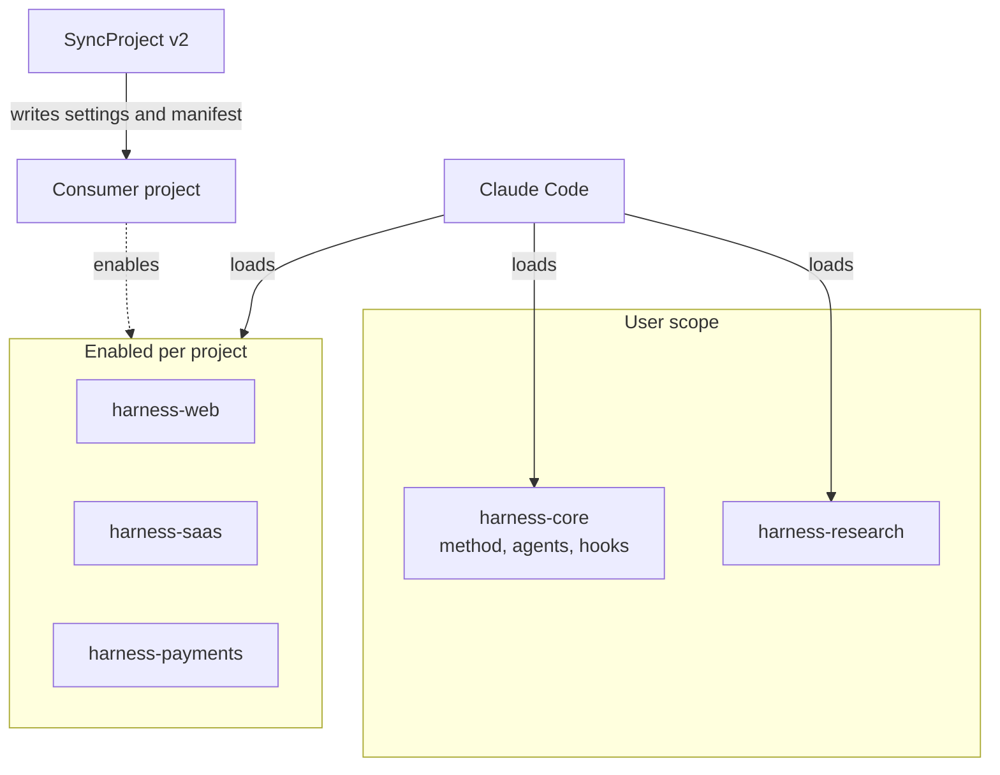
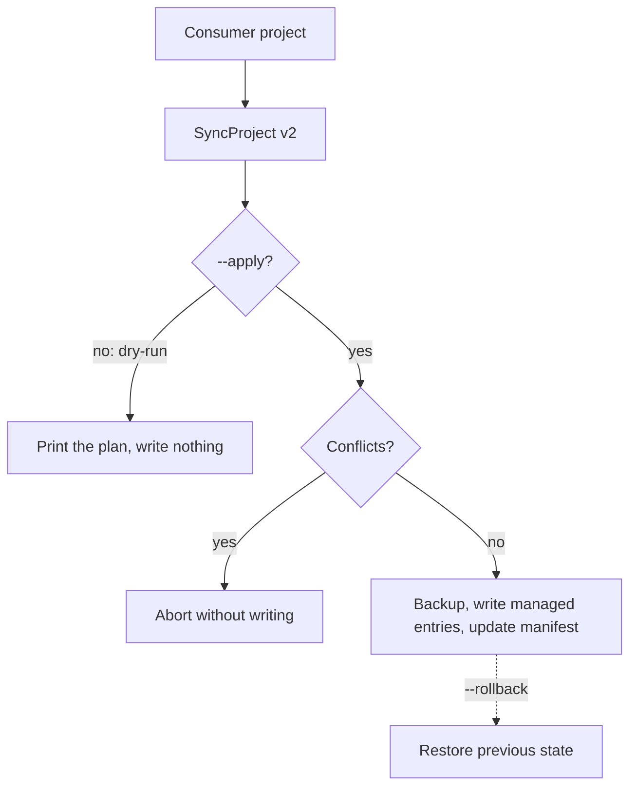
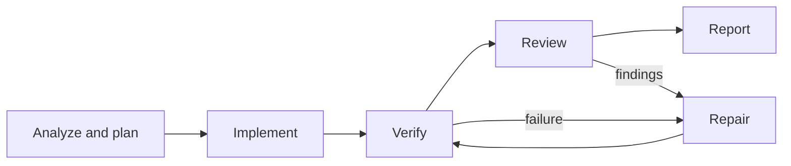

# Claude Code Harness

### A Modular Engineering Framework for AI-Assisted Web and SaaS Development

[](https://github.com/MarBlanco/ClaudeCode-agentes-skills/actions/workflows/harness-ci.yml)
[](LICENSE)

**From AI-generated code to verifiable software engineering.**

Claude Code Harness is a set of [Claude Code](https://claude.com/claude-code) plugins that helps the assistant work on web applications and SaaS products through specialized agents, reusable skills, security controls and independent quality verification. It covers frontend, backend, APIs, authentication, databases, multi-tenancy, payments, testing and security.

The goal is not simply to generate code, but to make AI-assisted development more structured, reusable and verifiable.

## Why this Harness?

An autonomous assistant left to its own devices can call work "done" because it compiles, touch sensitive files, retry without limit or lose context between sessions. The Harness adds an engineering structure around that process:

- **Modular architecture:** a shared core plus specialized plugins.
- **Defined workflow:** consistent phases from analysis to verification, with a bounded repair loop.
- **Specialized agents:** separate implementation, review and QA responsibilities.
- **Independent verification:** nine quality gates with explicit results and saved evidence.
- **Security controls:** hooks, per-agent policies and approval requirements.
- **Project portability:** SyncProject v2 applies Harness configuration to a project without overwriting its own.

A key principle guides the design:

> The agent that implements a change should not be the only authority deciding whether that change is correct.

## Architecture

A common core provides the methodology and shared controls; plugins add capabilities for specific domains. Project modules are installed once and enabled only in the projects that need them, so unused skills do not consume context.



| Plugin | Scope | Responsibility |
|---|---|---|
| `harness-core` | user | Methodology (product spec, architecture decisions, plan, work, review), `code-reviewer` and `qa-verifier` agents, quality-gate catalogue, hooks and shared policies |
| `harness-web` | per project | Frontend engineering, design, web QA, accessibility, SEO, OWASP guidance; `qa-explorer` agent |
| `harness-saas` | per project | SaaS architecture, APIs and webhooks, authentication, data modeling and migrations, multi-tenancy |
| `harness-payments` | per project | Payment flows, backend authority, idempotency, webhook security; `payments-engineer` agent |
| `harness-mods` | user | Interface mod for Claude Code: a model-picker button (rule-based, no model call) that suggests, or sets when the Claude Code version allows it, Haiku, Sonnet or Opus from the prompt difficulty. Tested with the engine test kit only, not in a real interactive session |
| `prompt-enhancer` | user | Own Prompt Enhancer mod: an always-visible Enhance button that turns a short idea into a complete prompt with one Haiku call. Works in panels where the third-party enhancer below does not show its button (e.g. the VS Code panel) |
| `cc-prompt-enhance-mod` | user | Third-party Prompt Enhancer by Yigit Budak ([upstream](https://github.com/yibudak/cc-prompt-enhance-mod), MIT), included **unmodified**: an Enhance button that uses Sonnet and the recent conversation to sharpen your draft; Revert undoes it. One Sonnet call per press (more tokens than a Haiku-only enhancer; not measured here) |
| `harness-research` | user | Market and web research with explicit evidence classification; `market-researcher` agent |

### Project profiles

`vite-supabase`, `next-supabase`, `next-payload`, `next-drizzle` and `django-react` select the modules, permissions, gate commands and CI files for a stack. They do not replace a project's own architecture or configuration.

## SyncProject v2

A CLI that installs and maintains Harness configuration across repositories without blindly overwriting project-specific settings. Unlike a file copier, it tracks the resources it manages and detects changes that could conflict.



- Dry-run by default; idempotent re-sync; backup before every apply; rollback.
- Tracks what it wrote in `.claude/harness.manifest.json`; only those entries are ever modified or removed.
- Manages plugin enablement, selected permissions and MCP entries, a block in `.gitignore` and allow-listed CI files. It never overwrites `CLAUDE.md`, `settings.local.json`, or project-owned skills and agents.
- Existing entries with matching values are adopted; unexpected manual edits of managed entries are conflicts, not silently overwritten.

```bash
node scripts/sync-project.mjs --project <path> --profile next-supabase            # dry-run
node scripts/sync-project.mjs --project <path> --profile next-supabase --apply    # backup and apply
node scripts/sync-project.mjs --project <path> --list-backups
node scripts/sync-project.mjs --project <path> --rollback
```

`scripts/sync-project.ps1` is a PowerShell wrapper with the same parameters.

## Engineering workflow



Repair is limited to three cycles; after that the work stops and reports what remains.

| Agent | Responsibility |
|---|---|
| `code-reviewer` | Independent code review and identification of implementation risks |
| `qa-verifier` | Runs the selected quality gates and stores the evidence |
| `qa-explorer` | Exploratory browser testing of user flows, with regression specs |
| `payments-engineer` | Payment implementation under the `payments-core` invariants |
| `market-researcher` | Evidence-based market and web research |

Agents have different tool lists. `code-reviewer` and `qa-verifier` have no edit tools, but they do have Bash to run commands, so "read-only" means no edit tools plus instructions, not an operating-system sandbox. Definitions do not guarantee that a task will invoke them: that depends on the workflow, available tools and configuration.

## Quality gates

| Gate | Verification | Gate | Verification |
|---|---|---|---|
| G1 | Build, types, lint | G6 | Security (secrets, dependencies) |
| G2 | Unit and integration tests | G7 | Performance |
| G3 | End-to-end tests | G8 | Database |
| G4 | Visual and responsive | G9 | Payments |
| G5 | Accessibility | | |

Each gate reports `PASS`, `FAIL`, `BLOCKED` or `NOT_CONFIGURED`. `NOT_CONFIGURED` never counts as a pass, and a gate passes only with saved evidence. Which gates apply depends on the risk level of the change ([catalogue](plugins/harness-core/skills/harness-review/references/gates.md)).

The verifier uses the tooling of the consumer project. The Harness defines the method; it does not ship a universal test runner for every technology.

## Security and execution controls

| Control | Type |
|---|---|
| Reading or editing `.env*`, private keys and credentials files, including through shell commands | Denied by hook |
| Manual lockfile edits, edits of committed migrations, `git push --force`, commits on `main`/`master` | Denied by hook |
| Push, hard reset, destructive SQL, production deploys, publishing | Requires user confirmation |
| Manifest commands (typecheck, format) | Run only if the user approved their hash, stored outside the repo |
| `qa-explorer`: writes only inside its run folder, shell limited to `playwright-cli`, browser restricted to local origins | Enforced by policy |
| `qa-explorer`: do not click "pay", do not submit real data | Instructions only |

These controls reduce risk but are **not** an operating-system sandbox. A script that opens files by itself, obfuscated file names or a malicious spec approved without review can bypass them, and the `qa-explorer` policy does not contain a deliberately hostile agent. The guard fails open if its own process breaks. Details: [`docs/CAPABILITIES.md`](docs/CAPABILITIES.md) (sections 5 and 7).

## Verification and demos

```bash
npm test                  # hooks, agent policy, SyncProject, payments references, consistency checker
npm run check:skills      # skill frontmatter, unique names, referenced paths
npm run check:consistency # versions, hooks, agent tools, private paths, license files
npm run validate          # claude plugin validate --strict (needs the claude CLI)
npm run demo:sync         # SyncProject on a temporary project: dry-run, apply, idempotence, conflict, rollback
npm run demo:qa           # regression specs against a seeded-defect app (needs a Playwright runner)
```

- `demo:sync` runs the real CLI and exits non-zero if any outcome differs from the expected one.
- `demo:qa` runs 18 specs twice against [`qa-app`](plugins/harness-web/tests/fixtures/qa-app), a small shop with seeded defects: the 7 healthy-journey specs pass and the 11 defect specs fail, identically in both runs. Runner setup and the provenance of the included real agent run: [`examples/qa-explorer-run`](examples/qa-explorer-run/README.md). It is not part of CI.

**CI** ([workflow](.github/workflows/harness-ci.yml)) runs on push to `main` and on pull requests: tests, skill and consistency checks on Ubuntu and Windows, plugin validation with Claude Code 2.1.319, and a gitleaks scan of the full history. Actions are pinned by commit SHA; there are no deployments or releases. CI validates this repository's checks; it does not certify any consumer project.

## Installation

Requirements: Node ≥ 22, Git and Claude Code (plugin validation and mods tested with 2.1.319; earlier hardening with 2.1.316). The documented installation targets **Windows / PowerShell**; the repository has no runtime dependencies to install.

```bash
git clone https://github.com/MarBlanco/ClaudeCode-agentes-skills.git
cd ClaudeCode-agentes-skills
npm test && npm run check:skills && npm run check:consistency   # optional: verify before installing
```

```powershell
.\scripts\install-harness.ps1 -Marketplace   # global rules, "harness" marketplace, harness-core (user scope)
.\scripts\install-qa-tools.ps1               # gitleaks, osv-scanner, actionlint, hadolint (SHA-256 verified)

# Project modules: install, disable at user scope, then enable per project with SyncProject
claude plugin install harness-web@harness      --scope user; claude plugin disable harness-web      --scope user
claude plugin install harness-saas@harness     --scope user; claude plugin disable harness-saas     --scope user
claude plugin install harness-payments@harness --scope user; claude plugin disable harness-payments --scope user
claude plugin install harness-research@harness --scope user
claude plugin install harness-mods@harness     --scope user   # optional: "Modelo justo" button
claude plugin install prompt-enhancer@harness --scope user   # optional: own Enhance button
claude plugin install cc-prompt-enhance-mod@harness --scope user   # optional: third-party Prompt Enhancer (terminal; same hotkey, enable only one)
```

## Current limitations

- Only Claude Code 2.1.316 (hardening) and 2.1.319 (plugin validation, mods) were exercised. Windows is the documented installation platform; Ubuntu is covered by CI; **macOS has not been validated**.
- Skills are instructions, not guarantees: whether one is loaded depends on the model.
- `qa-explorer` is exploratory and **non-deterministic**; it has no operating-system isolation.
- Memory, session continuity and the model hint (`router.mjs`) are assistance. The model hint is only a suggestion — it does not switch the active model — and **no token or cost saving is claimed or measured**.
- Some capabilities (for example SaaS, SEO, deployment and observability guidance) have not been exercised against a real backend, site or deployment; research workflows have no complete end-to-end execution record. [`docs/CAPABILITIES.md`](docs/CAPABILITIES.md) states the verification status of each item.
- Results depend on the tools, dependencies and configuration of each consumer project. The tests and demos are evidence for specific behaviors, not a universal guarantee.

## Repository structure

```text
.claude-plugin/    marketplace catalogue
plugins/           harness-core, harness-web, harness-saas, harness-payments, harness-research, harness-mods
templates/         stack profiles and managed CI workflow
scripts/           sync-project, installers, checks, demos, tests
examples/          real QA Explorer run (report, screenshots, specs)
global/            global working rules (installed as ~/.claude/HARNESS.md)
docs/              architecture decision records and capability matrix (in Spanish)
.github/           CI workflow
harness.lock.json  versioned inventory of components and provenance
```

## License

[Apache License 2.0](LICENSE) for the original code and documentation (see [NOTICE](NOTICE)). Vendored third-party components keep their own licenses; provenance and pinned commits are in [`harness.lock.json`](harness.lock.json), [`plugins/harness-research/NOTICE.md`](plugins/harness-research/NOTICE.md) and [`upstream-licenses.md`](plugins/harness-web/skills/qa-explore/references/upstream-licenses.md). `hadolint` (GPL-3.0) is used only as a command-line tool.
