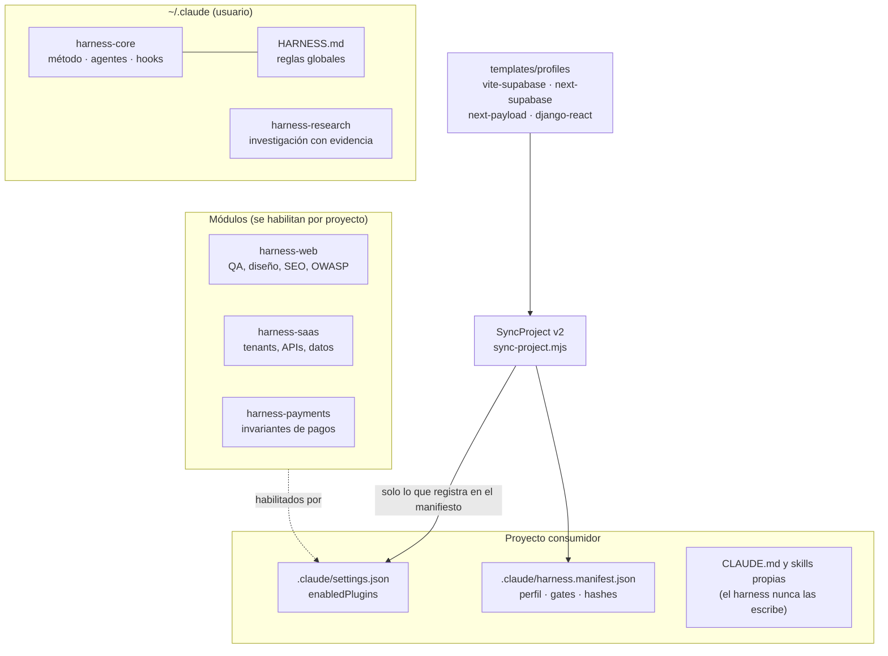
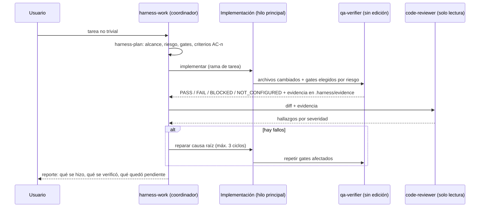
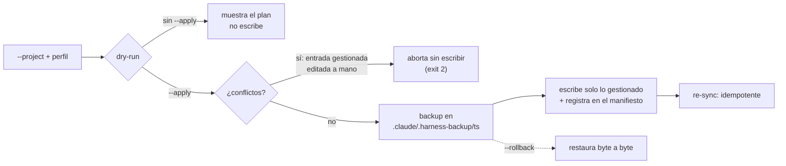

# Claude Code Harness

[](https://github.com/MarBlanco/ClaudeCode-agentes-skills/actions/workflows/harness-ci.yml)
[](LICENSE)

Un *harness* para [Claude Code](https://claude.com/claude-code): una capa de método, agentes especializados, controles preventivos y verificación con evidencia que se instala como marketplace de plugins y se aplica a cada proyecto sin pisar su configuración.

> **Idea central:** quien implementa nunca certifica su propio trabajo. La verificación la hace otro agente sin permisos de edición, con salida observada guardada como evidencia, y toda afirmación del sistema debe poder demostrarse con un test, una ejecución o una limitación declarada.

## Qué problema resuelve

Un asistente de código autónomo, sin estructura, tiende a: declarar "listo" lo que solo compila, tocar archivos sensibles (`.env`, lockfiles, migraciones), repetir intentos sin límite, perder el hilo entre sesiones y gastar contexto en capacidades que no usa. El Harness aborda esos riesgos con mecanismos concretos y comprobables:

| Riesgo | Mecanismo | Tipo de control |
|---|---|---|
| Declarar terminado sin evidencia | Agente `qa-verifier` (sin edición) + nueve *gates* G1–G9 con evidencia en disco | Proceso verificable |
| Auto-aprobación | Separación implementador / `qa-verifier` / `code-reviewer` (solo lectura) | Permisos por agente |
| Filtrar o modificar secretos, lockfiles, migraciones | Hook `PreToolUse` (*guard*) que **deniega** | Preventivo |
| Operaciones destructivas o de producción | El guard pide confirmación (push, reset duro, `DROP`, `vercel --prod`…) | Confirmación |
| Bucles infinitos de reparación | Máximo de 3 ciclos y reporte de bloqueo | Regla del flujo |
| Exploración QA que podría salirse de su alcance | Política por agente (`qa-explorer`) + red del navegador limitada a `localhost` | Preventivo (con límites declarados) |
| Perder contexto entre sesiones | Hook de continuidad + política de memoria | Asistencia |
| Configuración de proyectos desalineada | **SyncProject v2**: aplica perfiles de forma idempotente, con conflictos, backup y rollback | Preventivo |

## Arquitectura



| Capa | Dónde | Qué aporta |
|---|---|---|
| Core | `plugins/harness-core` (usuario, siempre activo) | Método (`product-spec` → `architecture-decisions` → `harness-plan` → `harness-work` → `harness-review`), agentes `code-reviewer` y `qa-verifier`, catálogo de gates, hooks |
| Módulos | `harness-web`, `harness-saas`, `harness-payments` | Conocimiento y verificación de dominio; cargados solo en los proyectos que los necesitan para no gastar contexto |
| Investigación | `harness-research` (usuario) | Investigación de mercado/web con niveles de evidencia (`verified_sales` / `popularity` / `hypothesis`), nunca cifras inventadas |
| Perfiles | `templates/profiles` | Componen módulos, MCP, permisos, comandos de gates y archivos de CI según el stack |

Decisiones de diseño y alternativas descartadas: [`docs/DECISIONS.md`](docs/DECISIONS.md) (ADR-001…018). Matriz de capacidades con su estado de verificación real: [`docs/CAPABILITIES.md`](docs/CAPABILITIES.md).

## Cómo trabajan los agentes



| Agente | Rol | Permisos declarados |
|---|---|---|
| `code-reviewer` | Revisión independiente (modelo `opus`) | Read, Grep, Glob, Bash |
| `qa-verifier` | Ejecuta gates y guarda evidencia (`sonnet`) | Read, Grep, Glob, Bash (sin Edit/Write) |
| `qa-explorer` | Exploración QA autónoma como cliente (`sonnet`) | Read, Grep, Glob, Write (solo la corrida), Bash (solo `playwright-cli`), Skill |
| `payments-engineer` | Implementación de pagos bajo `payments-core` (`opus`) | Read, Grep, Glob, Edit, Write, Bash, Skill |
| `market-researcher` | Investigación web de solo lectura (`sonnet`) | WebSearch, WebFetch, Read, Grep, Glob |

Estos permisos están declarados en el *frontmatter* de cada agente y `npm run check:consistency` verifica que los agentes "de solo lectura" no declaren herramientas de escritura. `NOT_CONFIGURED` nunca cuenta como `PASS`.

**Modelo por tarea.** El hook `router.mjs` sugiere (sin llamar a ningún modelo) delegar búsquedas amplias a un modelo barato o reforzar la revisión en tareas de riesgo alto; la tabla está en [`harness-work/references/model-routing.md`](plugins/harness-core/skills/harness-work/references/model-routing.md). Es una **sugerencia**: un hook no puede cambiar el modelo, y el ahorro **no está medido**.

## Seguridad: qué se previene y qué no

| Control | Tipo | Evidencia |
|---|---|---|
| Lectura/edición de `.env*`, claves privadas, `.credentials.json`, también vía Bash/Grep/Glob y con rutas de Windows o POSIX | **Preventivo** (hook, deniega) | tests del guard |
| Edición de lockfiles y de migraciones ya versionadas; `push --force`; `commit` en `main`/`master` | **Preventivo** | tests del guard |
| Push, reset duro, `DROP`/`TRUNCATE`, `supabase db push`, `vercel --prod`, publicar | Confirmación del usuario | tests del guard |
| Comandos del manifiesto (typecheck, formato) | Solo se ejecutan si su hash fue aprobado por el usuario, guardado **fuera del repo** | tests |
| `qa-explorer`: escritura solo en su corrida; Bash reducido a `playwright-cli`; navegador con proxy sumidero y orígenes locales; sesiones solo las abiertas por el guard | **Preventivo** (falla cerrada) | tests de política (cada *bypass* hallado en revisiones adversariales es un caso de regresión) + pruebas reales |
| `qa-explorer`: no pulsar "pagar", no enviar datos reales, redactar secretos | **Solo instrucciones** | corridas observadas, sin garantía |
| Specs escritos por el agente | No los ejecuta el agente: los corre `qa-regression.mjs` tras revisión humana (`--reviewed`) | tests del runner |

**Límites declarados** (no se ocultan): en Windows nativo no hay *sandbox* de sistema; un script que abra archivos por su cuenta, nombres de archivo ofuscados o specs maliciosos revisados por descuido pueden esquivar los controles; la política del `qa-explorer` previene errores e instrucciones inyectadas por una página, **no contiene a un agente deliberadamente hostil**; el backend de la app bajo prueba puede cobrar si se pulsa "pagar" (requiere credenciales sandbox); el guard falla abierto si su propio proceso se rompe, apoyado en `permissions.deny`. Detalle y revisiones: [`docs/CAPABILITIES.md`](docs/CAPABILITIES.md) §5 y §7.

## SyncProject v2

Aplica un perfil a un proyecto consumidor de forma segura:



- Solo toca lo que **registró** en `.claude/harness.manifest.json`: entradas de `enabledPlugins`, reglas de `permissions`, `mcpServers` de `.mcp.json`, un bloque delimitado de `.gitignore` y archivos de CI de una lista blanca. Nunca `CLAUDE.md`, `settings.local.json` ni skills/agentes propios.
- Lo que el proyecto ya tenía igual se **adopta** y nunca se retira; lo gestionado y editado o borrado a mano es **conflicto**.
- Las rutas gestionadas están en lista blanca y contenidas en el proyecto (se rechazan `..`, rutas absolutas POSIX/Windows y UNC).

```bash
node scripts/sync-project.mjs --project <ruta> --profile next-supabase                 # dry-run
node scripts/sync-project.mjs --project <ruta> --profile next-supabase --apply         # backup + escritura
node scripts/sync-project.mjs --project <ruta> --rollback [<timestamp>]                # restaura
```

## Demostraciones reproducibles

Ninguna requiere credenciales ni toca proyectos reales.

```bash
npm run demo:sync    # SyncProject sobre un proyecto temporal: dry-run → apply → idempotencia → conflicto → rollback
npm run demo:qa      # regresión de QA sobre la app con 7 defectos sembrados (requiere un runner Playwright, ver abajo)
```

- **`demo:sync`** crea un proyecto temporal, ejecuta la CLI real y falla (exit 1) si algún resultado no es el esperado; corre en CI en Linux y Windows.
- **`demo:qa`** levanta [`qa-app`](plugins/harness-web/tests/fixtures/qa-app) (tienda de ejemplo con 7 defectos y un control de pago) y ejecuta 18 specs dos veces: los 7 recorridos sanos pasan y los 11 specs de defectos fallan, con resultado idéntico en ambas corridas. Incluye el informe y las capturas reales de una exploración del agente: [`examples/qa-explorer-run`](examples/qa-explorer-run) (con su procedencia y límites: la auditoría del agente es no determinista y se hizo con una versión anterior de su política).

## Calidad y verificación del propio Harness

```bash
npm test                 # hooks, política por agente, SyncProject, pagos, memoria, consistencia, fixture QA
npm run check:skills     # frontmatter, nombres únicos, rutas citadas existentes
npm run check:consistency# versiones (marketplace ↔ plugin ↔ lock ↔ CHANGELOG), hooks, permisos de agentes, privacidad, licencia
npm run validate         # claude plugin validate --strict (marketplace y plugins)
```

El pipeline ([`.github/workflows/harness-ci.yml`](.github/workflows/harness-ci.yml)) ejecuta tests, *skills* y consistencia en **Ubuntu y Windows**, la validación estricta de plugins, `gitleaks` sobre todo el historial (binario con SHA-256 fijado) y el chequeo semanal de actualizaciones. Permisos mínimos (`contents: read`), acciones fijadas por SHA, sin despliegues, sin publicaciones, sin auto-merge. Estado actual: ver el badge de arriba y la pestaña *Actions*; no se citan cifras de CI que no estén en una ejecución concreta.

### Módulos y sus pruebas

| Módulo | Qué aporta | Qué se prueba |
|---|---|---|
| `harness-web` | `web-qa` (Playwright, axe, Lighthouse CI), `qa-explore`, diseño, `seo`, `owasp-security` | política del `qa-explorer`, runner de regresión, app con defectos sembrados |
| `harness-saas` | multi-tenancy, auth y roles, APIs y webhooks, modelado/migraciones, buenas prácticas de PostgreSQL | validación de skills (contenido sin ejecutar contra un backend real: ver limitaciones) |
| `harness-payments` | invariantes de pagos (backend como autoridad, idempotencia, webhook verificado), referencias de código y matriz G9 | tests de las referencias (firma, máquina de estados, webhook con deduplicación, esquema SQL) |
| `harness-research` | investigación con evidencia y citas, análisis de datos | validación de skills |

## Instalación y prueba

Requisitos: Node ≥ 22, Git y [Claude Code](https://claude.com/claude-code) (validado con 2.1.316). Los scripts Node se probaron en Windows 10 y Ubuntu (WSL2); los instaladores `.ps1` son de PowerShell (Windows).

```bash
git clone https://github.com/MarBlanco/ClaudeCode-agentes-skills.git
cd ClaudeCode-agentes-skills
npm test && npm run check:skills && npm run check:consistency   # verificar sin instalar nada
npm run demo:sync
```

```powershell
# Instalación en Claude Code (Windows)
.\scripts\install-harness.ps1 -Marketplace        # HARNESS.md + marketplace "harness" + harness-core (scope usuario)
.\scripts\install-qa-tools.ps1                    # gitleaks, osv-scanner, actionlint, hadolint (SHA-256 verificado)
# Módulos de proyecto: instalados pero deshabilitados a nivel usuario; cada proyecto los habilita con SyncProject
claude plugin install harness-web@harness --scope user;      claude plugin disable harness-web --scope user
claude plugin install harness-saas@harness --scope user;     claude plugin disable harness-saas --scope user
claude plugin install harness-payments@harness --scope user; claude plugin disable harness-payments --scope user
claude plugin install harness-research@harness --scope user
```

Runner de regresión para `demo:qa` (una vez): `mkdir ~/.claude/harness/qa-runner && cd ~/.claude/harness/qa-runner && npm init -y && npm i @playwright/test && npx playwright install chromium`.

`~/.claude/settings.json` conviene que lleve además `permissions.deny` para `Read/Edit` sobre `.env*`; el guard cubre el resto como segunda línea.

## Tecnologías

Node.js (hooks y scripts `.mjs` sin dependencias de runtime, `node:test`), PowerShell (instaladores), formato de plugins y marketplaces de Claude Code, hooks de Claude Code, Playwright / `playwright-cli`, axe-core y Lighthouse CI (gates web), gitleaks y osv-scanner (G6), GitHub Actions, Mermaid (documentación).

## Limitaciones conocidas

- **Las skills son instrucciones, no garantías.** La activación de una skill depende del modelo; el enrutador y `harness-plan` la mejoran sin garantizarla (medido: activación espontánea parcial en pruebas pequeñas, ver `docs/CAPABILITIES.md` §6–7).
- **Sin aislamiento de sistema operativo** para el `qa-explorer` (evaluado Docker/WSL/`--permission`; pendiente de decisión). Es una política de herramientas más una restricción de red del navegador.
- **Memoria y modelo por tarea son asistencia**: los hooks de continuidad y la sugerencia de modelo no se midieron en uso interactivo prolongado; no se afirma ningún porcentaje de ahorro.
- **Contenido de `harness-saas`, `seo`, `ops-delivery` y observabilidad** es guía sin ejecutar contra un backend o sitio real; la matriz de capacidades marca cada una como *Implementada* o *Verificada* según lo que se comprobó.
- **La exploración autónoma del `qa-explorer` no es determinista**; el ejemplo incluido es una corrida real, no una garantía de cobertura.
- Probado en Windows 10 y Ubuntu (WSL2) con Node 24; macOS no probado.

## Estructura

```text
.claude-plugin/marketplace.json   catálogo "harness"
plugins/harness-core/             skills/, agents/, hooks/ (Node .mjs), tests/
plugins/harness-web/              skills/, agents/qa-explorer, scripts/qa-regression.mjs, tests/ (app con defectos sembrados)
plugins/harness-saas/             skills/
plugins/harness-payments/         skills/ (con referencias testeadas), agents/
plugins/harness-research/         skills/, agents/, NOTICE.md
templates/profiles, templates/ci  perfiles de stack y workflows gestionados
scripts/                          sync-project, install-*, check-*, demo-*, memory-lint, update-check, tests/
examples/qa-explorer-run/         informe, capturas y specs reales de una exploración
global/HARNESS.md                 reglas globales (se instalan como ~/.claude/HARNESS.md)
harness.lock.json                 inventario versionado de cada componente y su procedencia
docs/                             DECISIONS.md (ADR), CAPABILITIES.md
```

## Actualización continua y reversión

- `npm run update-check`: compara `harness.lock.json` con el upstream (releases, commits, npm). Solo lectura; en CI abre o actualiza un issue semanal.
- Componentes críticos (hooks, permisos, pagos, core) nunca se actualizan solos: se prueban en rama y se actualiza el lock.
- Reversión: SyncProject guarda un backup por `--apply` (`--rollback`); los plugins se revierten bajando la versión; el repo, con git.

## Licencia y atribuciones

Código y documentación propios: [Apache-2.0](LICENSE) © 2026 Martin Blanco ([NOTICE](NOTICE)). Las skills y scripts vendorizados de terceros (Anthropic, Vercel, Supabase, Microsoft, y otros MIT/Apache-2.0) conservan su licencia original; procedencia y commits fijados en [`harness.lock.json`](harness.lock.json), [`plugins/harness-research/NOTICE.md`](plugins/harness-research/NOTICE.md) y [`upstream-licenses.md`](plugins/harness-web/skills/qa-explore/references/upstream-licenses.md). `hadolint` (GPL-3.0) se usa solo como herramienta de línea de comandos, sin incorporarse al código.
